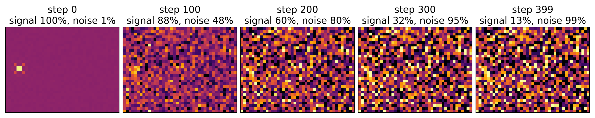
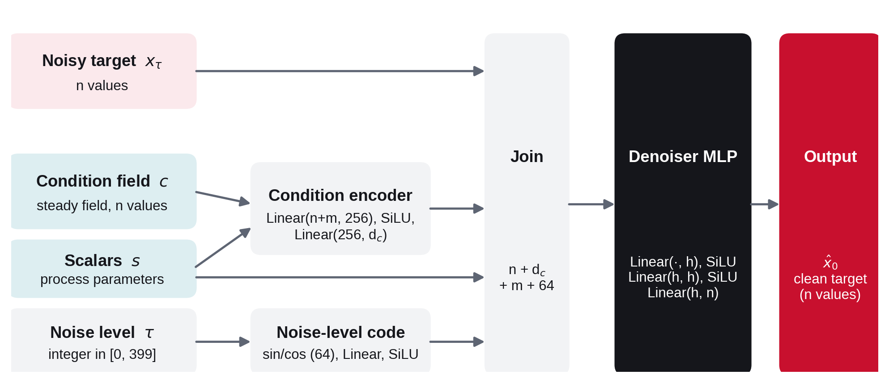
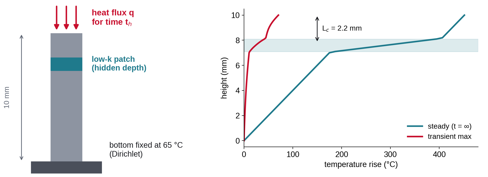
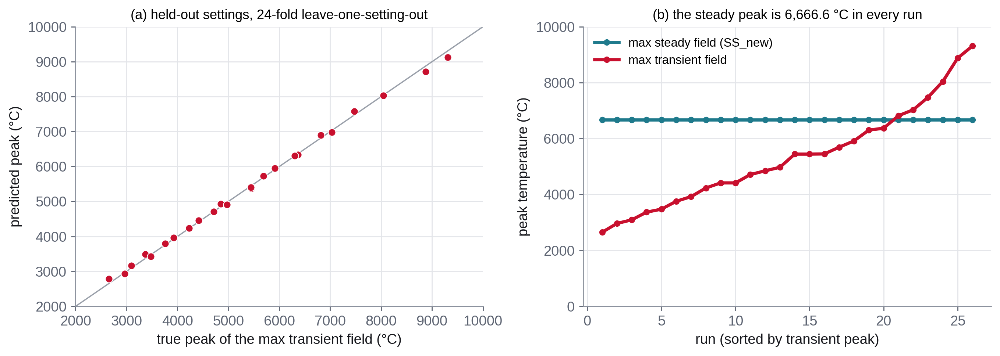
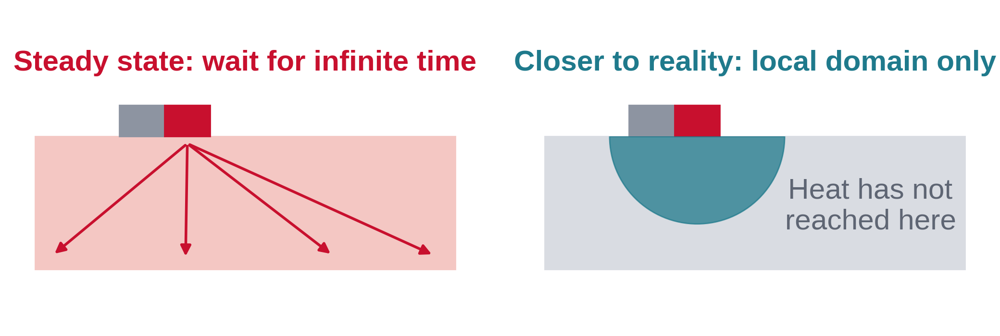
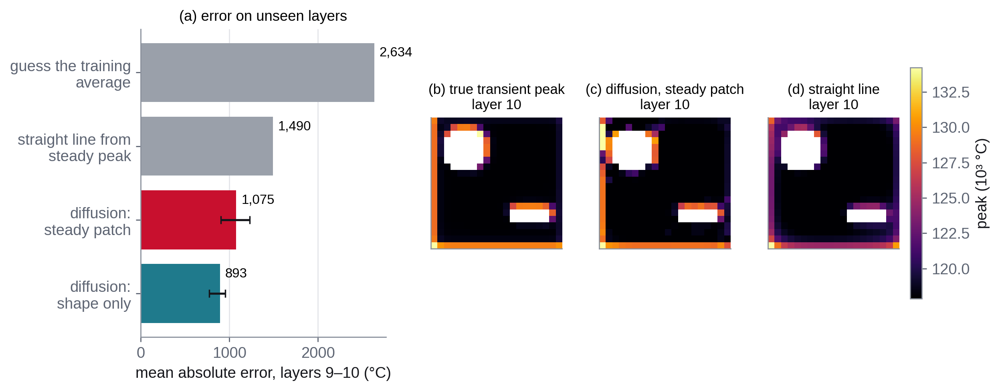

<div align="center">

# Steady-state → transient temperature in laser powder bed fusion

**Can a fast steady-state thermal response predict the hotspots of a slow transient simulation?**


B.Tech project · Department of Mechanical Engineering · IIT Jodhpur · 2026<br>
**Ayush Gupta** (B23ME1014) · supervisor **Dr. Rajit Ranjan**

📄 [Report (PDF)](docs/BTP_report.pdf) · 🎞️ [Presentation (PDF)](docs/BTP_final_presentation.pdf)

</div>

---

## TL;DR

In laser powder bed fusion (LPBF), heat that cannot escape to the baseplate overheats the part. A **transient**
thermal simulation finds these hotspots accurately but slowly (**21 h 28 min** for one part); a **steady-state**
simulation is about **600× faster** (2 min 9 s) but only qualitative
([Ranjan et al., 2020](https://doi.org/10.3390/ma13204576)).

We trained a **conditional diffusion model** to turn steady-state fields into transient ones, on three cases of
increasing realism, and found:

> 💡 **The steady → transient mapping makes sense as a _geometry_ mapping, not as a mapping of the process
> parameters** (laser power *P*, scan speed *v*, hatch spacing *h*).

## Results at a glance

| Case | What it is | Result on unseen data | What it taught us |
|---|---|---|---|
| **1 · 1D rod** | heat flux on top, fixed bottom, hidden low-conductivity patch | **4.3 %** peak error (steady field alone: +932 %) | the steady field helps only when it carries hidden information |
| **2 · Single bead** | real thermal model, 27 settings of *P*, *v*, *h* | **1.3 %** peak error… | …but all 27 steady fields are identical (±0.12 °C): one geometry → no information |
| **3 · Geometry** | block with a hole and a slot, 3,844 elements | **2.5×** lower error than a constant guess | the geometry itself carries the signal |

---

## How it works

**Diffusion in three steps** ([`model/diffusion_model.py`](model/diffusion_model.py)):

1. **Add noise** to the true transient field: x<sub>τ</sub> = √ᾱ<sub>τ</sub> x<sub>0</sub> + √(1 − ᾱ<sub>τ</sub>) ε (400 noise levels).
2. **Train** a network to recover the clean field x<sub>0</sub> from the noisy one, guided by the steady-state field and the process parameters (loss ‖f<sub>θ</sub> − x<sub>0</sub>‖²).
3. **Generate** from pure noise in 50 DDIM steps and average 8 samples.

<p align="center"></p>
<p align="center"></p>

Every number in this README is measured on simulations the model **never saw** and compared with simple baselines.
Diffusion learns a distribution while this problem is deterministic; averaging the samples makes it behave like a
regressor (the report discusses where it does not fit).

---

## Case 1 · 1D rod

<p align="center"></p>

A 10 mm rod: heat flux *q* enters at the top for a time *t*<sub>h</sub>, the bottom is held at 65 °C, and a
low-conductivity patch sits at a **hidden** depth. The model sees the steady field, *q* and *t*<sub>h</sub>.
1,600 training runs, 300 unseen test runs.

| 300 unseen runs | Mean peak error |
|---|---|
| Steady field used directly | +932 % |
| **Diffusion with the steady field** | **4.3 %** (median 2.4 %) |
| Diffusion without the steady field | 25.8 % |
| Everything given as numbers (with / without steady field) | 1.9 % / 2.1 % |

📏 **The local domain, in 1D.** The steady field feels the patch at any depth, the transient only near the top
(*L*<sub>c</sub> = √(α *t*<sub>h</sub>), medians over the test runs):

| Patch depth below the top | < 1 *L*<sub>c</sub> | 1–2 *L*<sub>c</sub> | 2–4 *L*<sub>c</sub> | > 4 *L*<sub>c</sub> |
|---|---|---|---|---|
| Steady peak rise | +43 % | +39 % | +53 % | +51 % |
| Transient peak rise | +42 % | +4 % | 0 % | 0 % |

<details>
<summary>Earlier 1D version: a laser moving along the rod</summary>

A Gaussian source of power *P* moves at speed *v* along a rod with both ends at 65 °C; the material is hidden.
Mean peak error on 300 unseen runs: **1.0 %** with 1,600 training runs (3.0 % with 25), against 174 % for the steady
field taken as the answer and 18 % without the steady field; with every property given as a number, 0.76 % with
and 0.72 % without it. This is the version described in the report.
Results: [`results/case1_rod_moving_laser/`](results/case1_rod_moving_laser).
</details>

## Case 2 · Single-bead deposition

<p align="center"></p>

One bead on a plate, simulated with the thermal model of Ranjan et al. for 27 settings
(*P* ∈ {60, 90, 120} W, *v* ∈ {10, 50, 100} mm/s, *h* ∈ {0.10, 0.15, 0.18} mm).
Max steady field + *P*, *v*, *h* → max transient field, 24-fold leave-one-setting-out.

* ✅ Mean peak error **1.3 %** (worst 5.1 %), RMSE 9.8 °C, hot-spot overlap 1.00.
* ⚠️ But the localised steady fields of all 27 runs are **identical within 0.12 °C** (peak 6,666.6 °C every time) while
  the transient peak ranges from 2,652 to 9,311 °C. All the accuracy comes from *P*, *v*, *h*.

<details>
<summary>Earlier formulation: transient snapshots at whole-number times</summary>

Cross-validated RMSE over all nodes and times: plain diffusion 6.85 °C, nearest training setting 4.46 °C,
amplitude × shape model 0.22 °C, regression + diffusion residual 0.22 °C. With 26 runs, structure had to be
supplied rather than learned. Results: [`results/case2_snapshot_task/RESULTS.md`](results/case2_snapshot_task/RESULTS.md).
</details>

## Why Case 2 fails: the local domain

<p align="center"></p>

A steady state means waiting for **infinite time**, so heat would reach the whole part. In a real build the next bead
arrives long before that: heat travels only about a characteristic length **L<sub>c</sub> = √(α t)**, with
α = k/(ρc<sub>p</sub>) (four times the time → only twice the distance). The steady analysis is therefore done on a
**local domain**. With one standard geometry, every bead sees the same local domain, so the steady field cannot
change. With walls and voids nearby, the domains differ from bead to bead and the steady field encodes the geometry.

## Case 3 · Geometry

<p align="center"></p>

A 20 × 20 mm block, 10 layers, with a hole and a slot, built element by element (3,844 steady/transient pairs).
Both peaks rise next to walls and voids (correlation 0.88 from element 1,365 on). Trained on layers 1–8, tested on
the unseen layers 9–10, where the round hole is new:

| Method | Mean absolute error |
|---|---|
| Guess the training mean | 2,634 |
| Straight line from the steady peak | 1,490 |
| **Diffusion, 5 × 5 steady patch** (3 seeds) | **1,075** (903–1,231) |
| Diffusion, **shape only** (3 seeds) | 893 (771–955) |

The shape alone is as informative as the steady values: **the signal is the geometry**. The dataset's temperatures
(~10⁵ °C) are not physical, so only patterns are compared; see [`DATA_REPORT.md`](results/case3_geometry/DATA_REPORT.md).

---

## Repository layout

```
├── docs/            report and presentation (PDF), README images
├── model/           diffusion_model.py (all cases) · bead_model.py (snapshot task)
├── simulators/      rod_flux_sim.py (Case 1) · rod1d_sim.py (moving-laser rod)
├── data_loaders/    maxmap_data.py · bead2_data.py · bead_data.py · tts_data.py · wall_data.py
├── training/        one script per experiment (table below)
├── analysis/        data checks and result summaries
├── results/         saved results, one folder per case
└── data/            simulation datasets (local only, not in the repository)
```

| Case | Simulator / loader | Training | Analysis | Results |
|---|---|---|---|---|
| 1 · rod | `simulators/rod_flux_sim.py` | `training/rod_flux_experiment.py` | – | [`results/case1_rod/`](results/case1_rod) |
| 1 · moving-laser rod | `simulators/rod1d_sim.py` | `training/rod1d_experiment.py`, `rod1d_allparams.py` | – | [`results/case1_rod_moving_laser/`](results/case1_rod_moving_laser) |
| 2 · single bead | `data_loaders/maxmap_data.py` | `training/maxmap_train.py` | `analysis/maxmap_analyze.py`, `maxmap_report.py` | [`results/case2_single_bead/`](results/case2_single_bead) |
| 2 · snapshot task | `data_loaders/bead2_data.py`, `bead_data.py` | `training/bead2_train.py`, `bead2_hybrid.py`, `bead2_best_model.py` | `analysis/bead2_report.py` | [`results/case2_snapshot_task/`](results/case2_snapshot_task) |
| 3 · geometry | `data_loaders/tts_data.py` | `training/tts_model.py` (`--checks`: seeds, shape only) | `analysis/tts_analyze.py` | [`results/case3_geometry/`](results/case3_geometry) |
| wall study | `data_loaders/wall_data.py` | `training/baselines.py`, `diffusion_compare.py` | – | – |

## Quick start

```bash
git clone git@github.com:ayushgupta67/btp-lpbf-steady-to-transient.git
cd btp-lpbf-steady-to-transient
python -m venv .venv && .venv/bin/pip install -r requirements.txt

# Case 1 needs no data: it simulates its own rods (about 1.5 min on a laptop CPU)
.venv/bin/python simulators/rod_flux_sim.py          # quick look at a few runs
.venv/bin/python -u training/rod_flux_experiment.py  # -> results/case1_rod/
```

<details>
<summary>Cases 2 and 3 (need the simulation datasets)</summary>

Place the datasets (not included) under `data/`:

```
data/Updated_complete_dataset_singlebead/Single_bead_Data_set/Transient/   # Case 2 transient runs
data/SS_new/dataset/                                                       # Case 2 localised steady state
data/Trans_to_SS_dataset/part_1/{SS,Trans}/                                # Case 3
data/Transient_wall/, data/Steady_state_wall/                              # wall study
```

```bash
.venv/bin/python analysis/maxmap_analyze.py
.venv/bin/python -u training/maxmap_train.py --epochs 1500   # the reported run used 1,500 epochs
.venv/bin/python analysis/maxmap_report.py
.venv/bin/python analysis/tts_analyze.py
.venv/bin/python -u training/tts_model.py && .venv/bin/python -u training/tts_model.py --checks
```

Scripts can be run from any directory: each finds the other folders relative to its own location.
Training on a multithreaded CPU is not bit-for-bit repeatable; re-running the Case 3 checks reproduced four of five
saved runs exactly (the fifth gave 785 instead of 903).
</details>

## Limitations

* Little data: 26 runs in Case 2 and one part in Case 3.
* Case 3 temperatures are not physical and its steady script misplaces the local domain for most elements, so it shows
  patterns, not temperatures, and tests new layers of the same part rather than a new part.
* Diffusion is a probabilistic model used on a deterministic problem; a deterministic field-to-field model could do the
  same job more cheaply.

## Reference

R. Ranjan, C. Ayas, M. Langelaar, F. van Keulen. *Fast detection of heat accumulation in powder bed fusion using
computationally efficient thermal models.* Materials 13(20), 4576 (2020).
[doi:10.3390/ma13204576](https://doi.org/10.3390/ma13204576)

**Acknowledgement.** The simulation datasets were generated by the research group with the thermal model of
Ranjan et al.; this project was supervised by Dr. Rajit Ranjan.
